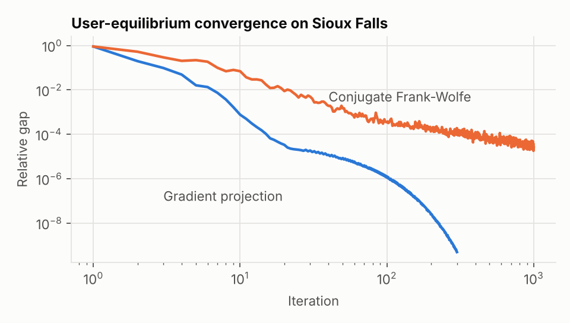
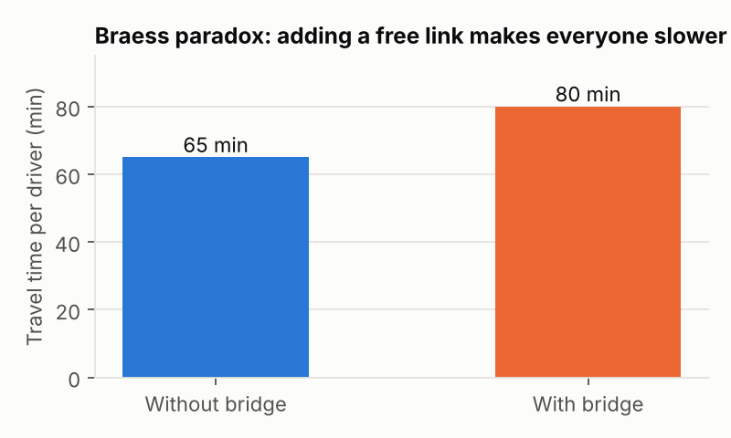
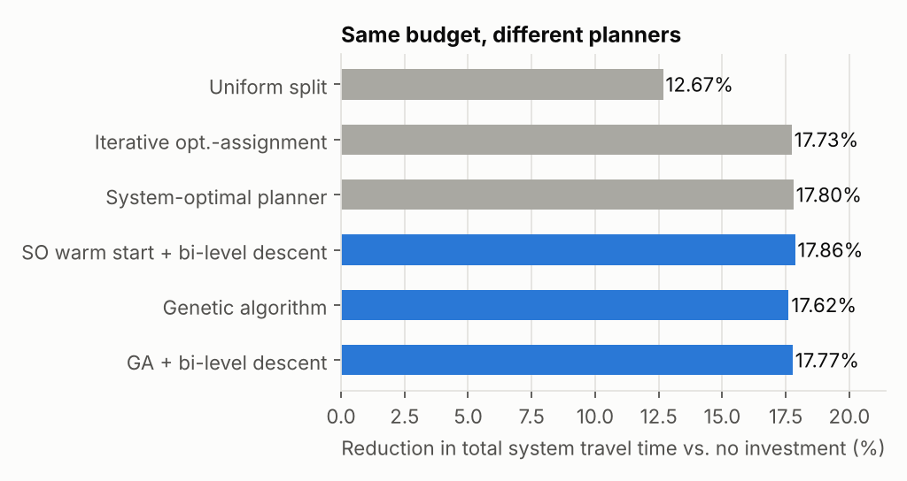
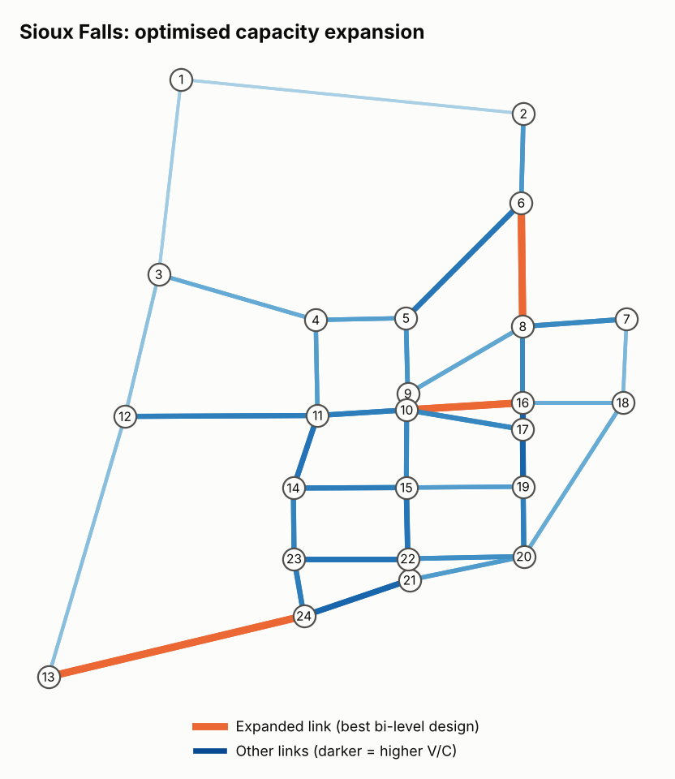

# Bi-Level Optimization for Traffic Network Design

A from-scratch Python implementation of the **bi-level (Stackelberg) network design problem**. A planner (leader) decides where to add road capacity, and drivers (followers) react by choosing their own fastest routes according to **Wardrop's user equilibrium**.

The code accompanies my Linear Optimization course project at Amirkabir University of Technology, *Bi-Level Optimization and Traffic Planning* (2024). That report surveyed the models; this repository implements and tests them on the standard **Sioux Falls** benchmark network.

## The problem

```
Upper level (planner):   min_y   TSTT(y) = Σ_a x_a(y) · t_a(x_a(y), y_a)
                         s.t.    Σ_a k_a y_a ≤ B,   0 ≤ y_a ≤ 1

Lower level (drivers):   x(y) = argmin_x  Σ_a ∫_0^{x_a} t_a(w, y_a) dw     (Beckmann / user equilibrium)
                         s.t.    flow conservation for every origin–destination pair
```

* `t_a` is the BPR travel-time function: `t0 · (1 + 0.15 · (x / c(1+y))^4)`.
* `y_a` is the added capacity on candidate link `a`, as a fraction of its current capacity.
* `k_a = length × capacity / 1000` is a lane-km cost proxy, and the budget `B` is 30% of the cost of doubling every candidate link.
* The candidates are the 10 links used in the classic continuous network design studies on Sioux Falls (Abdulaal & LeBlanc, 1979).

The difficulty is that the planner's objective depends on `x(y)`, which is itself the solution of an optimization problem. The resulting problem is non-convex even though each level is convex on its own.

## What is implemented

| Module | Contents |
|---|---|
| `src/network.py` | TNTP loader, BPR functions, Beckmann potential, Braess network |
| `src/assignment.py` | **Lower level**: user equilibrium and system optimum, solved by path-based **gradient projection** and link-based **conjugate Frank–Wolfe** |
| `src/ndp.py` | **Upper level**: budget-constrained network design, with five solution approaches (below) |
| `run_experiments.py` | Reproduces every number and figure in this README |

Upper-level approaches compared:

1. **Uniform split**: spend the budget evenly across candidates (naive baseline).
2. **Iterative optimization–assignment (IOA)**: fix flows, optimize capacity, re-assign, repeat. It ignores how drivers react, so it converges to a Cournot–Nash point rather than the Stackelberg optimum.
3. **System-optimal planner (SNDP)**: assume drivers follow the system optimum. This gives a single-level convex problem.
4. **Genetic algorithm**: a global search on the true bi-level problem, where every fitness evaluation solves a full user equilibrium.
5. **Bi-level descent**: SLSQP on `TSTT(x*(y))` using finite-difference gradients of the equilibrium response, warm-started from either SNDP or the GA.

## Results

### 1. Lower level is solved to benchmark accuracy



| | Value |
|---|---|
| User-equilibrium TSTT | **7,480,225** veh·min (matches the reference flows shipped with the dataset) |
| Beckmann objective | 4,231,335.29 (same as the reference flows) |
| Relative gap reached | 4.9 × 10⁻¹⁰ (gradient projection) vs. 2.6 × 10⁻⁵ after 1,000 iterations (conjugate Frank–Wolfe) |
| System-optimal TSTT | 7,194,256 veh·min |
| Price of anarchy | **1.040**: selfish routing costs 4.0% more total time than the system optimum |

### 2. Braess's paradox

On the classic 4,000-driver Braess network, adding a free link *raises* every driver's equilibrium travel time from **65 to 80 minutes**. This is the core reason network design must be modeled as a bi-level problem: the planner cannot assume that more capacity always helps.



### 3. Network design on Sioux Falls



| Method | TSTT (veh·min) | Reduction | UE solves | Time (s) |
|---|---:|---:|---:|---:|
| No investment | 7,480,217 | — | — | — |
| Uniform split | 6,532,540 | 12.67% | 1 | 1 |
| Iterative opt.–assignment | 6,153,856 | 17.73% | 13 | 6 |
| System-optimal planner | 6,148,634 | 17.80% | 234 SO | 412 |
| Genetic algorithm | 6,162,531 | 17.62% | 905 | 353 |
| GA + bi-level descent | 6,151,155 | 17.77% | 185 | 194 |
| **SO warm start + bi-level descent** | **6,144,157** | **17.86%** | 182 | 143 |

What the results show:

* **Where you spend matters more than how much.** With the same budget, a targeted design reduces total travel time by 17.9%, compared with 12.7% for an even split.
* **Modeling driver reaction gives the best design.** The best result comes from bi-level descent, which beats both single-level shortcuts (IOA and SNDP). The margins are small on this instance, under 0.2%, so the main lesson is the gap from the naive baseline rather than the ranking at the top.
* **The bi-level problem is non-convex.** Descent from the GA and descent from SNDP converge to different local optima. A good warm start matters as much as the search method.
* Every optimized design spends the full budget on the same three corridors, 6↔8, 10↔16 and 13↔24, and leaves the other candidate links almost untouched.



## Run it

```bash
pip install -r requirements.txt
python run_experiments.py          # full run, about 25 min on a laptop
python run_experiments.py --quick  # smaller GA for a quick check
```

Results are written to `results/summary.json` and the figures to `figures/`.

## Limitations and next steps

* The KKT / MPEC single-level reformulation discussed in the report is not implemented here. It would need a nonlinear complementarity or MILP solver, for example Pyomo with IPOPT, or Gurobi using a piecewise-linear BPR.
* Gradients of the equilibrium response are computed by finite differences. Analytical sensitivity analysis (Tobin & Friesz, 1988) would be faster.
* Demand is fixed. The elastic-demand model from the report is a natural extension.

## References

1. A. Migdalas, *Bilevel programming in traffic planning: Models, methods and challenge*, Journal of Global Optimization, 1995.
2. A. Sinha, P. Malo, K. Deb, *A review on bilevel optimization: From classical to evolutionary approaches and applications*, IEEE TEC, 2018.
3. S. Dempe, *Bilevel Optimization: Theory, Algorithms and Applications*.
4. S. D. Boyles et al., *Transportation Network Analysis*.
5. M. Abdulaal, L. J. LeBlanc, *Continuous equilibrium network design models*, Transportation Research B, 1979.
6. R. Jayakrishnan et al., *A faster path-based algorithm for traffic assignment*, TRR, 1994.
7. M. Mitradjieva, P. O. Lindberg, *The stiff is moving: Conjugate direction Frank–Wolfe methods*, Transportation Science, 2013.
8. Network data: [Transportation Networks for Research](https://github.com/bstabler/TransportationNetworks).

## Author

Maria MahdaviLayen, course instructor Dr. Hooshmand.
